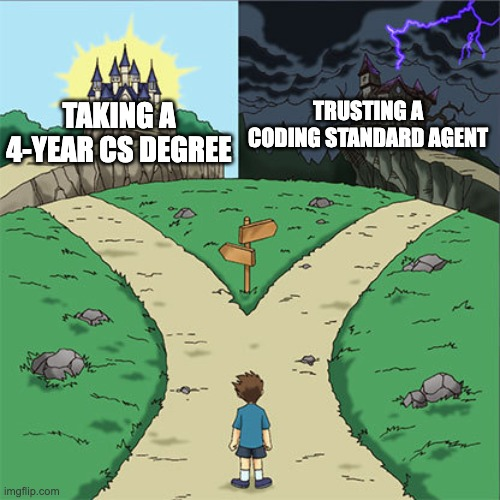
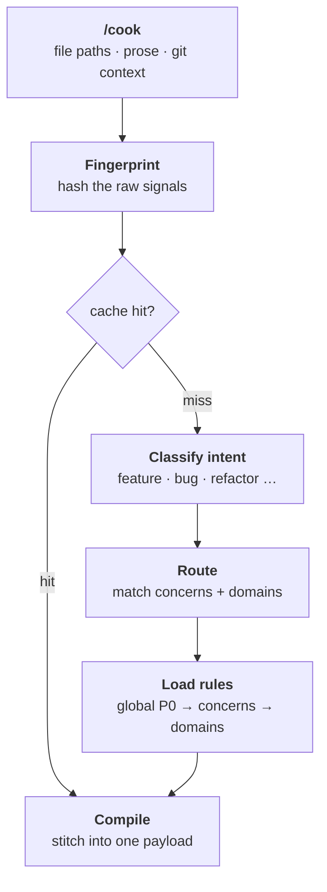

<div align="center">

<pre>
 ██████╗ ██████╗  ██████╗ ██╗  ██╗
██╔════╝██╔═══██╗██╔═══██╗██║ ██╔╝
██║     ██║   ██║██║   ██║█████╔╝ 
██║     ██║   ██║██║   ██║██╔═██╗ 
╚██████╗╚██████╔╝╚██████╔╝██║  ██╗
 ╚═════╝ ╚═════╝  ╚═════╝ ╚═╝  ╚═╝
</pre>



# 🧠 Cook

__Optimising the vibe in vibecoding.__

<p>
<a href="LICENSE.md"></a>


<a href="https://github.com/ndisisnd/cook/commits/main"></a>
</p>

<p>
<a href="#installation">Install</a> ·
<a href="#how-it-works">How it Works</a> ·
<a href="#faq">FAQ</a> ·
<a href="llms.txt">llms.txt</a>
</p>

<sub><b>AI agents / LLMs:</b> read <a href="llms.txt"><code>llms.txt</code></a>.</sub>

You've got brilliant ideas (that definitely are original and unique). You set up Claude Code, crack your joints, and fire up your favourite IDE (VSCode). You ask Claude, politely, to write the code for this feature that you believe is game-changing. 

*But wait, how do you know that Claude is writing... right?*

With little to zero software engineering knowledge, expertise, and skills, you can now outsource the blood, sweat, and tears of learning discrete mathematics, algorithms, and programming languages to this simple skill: `/cook`. Now, your coding agent can write the highest-quality code.

</div>

<!-- mkpub:release v1.1.0 -->
> [!NOTE]
> **🚀 New in v1.1.0 · iPhone and iPad standards, a cryptography concern, and smaller payloads**
>
> cook now covers iOS/iPadOS, ships its security rules in the public install, and refreshes the standards to October 2026 versions. Re-run the installer to pick it up.
> Update with `curl -fsSL https://raw.githubusercontent.com/ndisisnd/cook/main/install.sh | bash` · [Release notes](RELEASES.md)
<!-- /mkpub:release -->

___

`cook` is the knowledge layer. Before your coding agent starts planning or writing code changes, ask it to fire up `cook`. The skill checks your codebase, searches the most relevant coding references, compresses them, and outputs to your coding agent ready to be used.

Every run is saved — if the code changes are on the same programming languages, matches file extensions (e.g. `.tsx`), or similar types (e.g. creating a component), `cook` won't call the entire library of references again but simply refers to a cache of existing runs so it's faster and cheaper.

## Installation

Run this in your terminal:

```bash
curl -fsSL https://raw.githubusercontent.com/ndisisnd/cook/main/install.sh | bash
```

This installs cook to `~/.claude/skills/cook/`. To install somewhere else:

```bash
COOK_DIR=/path/to/destination bash install.sh
```

**Requirements:** `curl`, `tar`, `python3`

### OpenAI Codex CLI

cook is a plain Agent Skill, so one install serves both agents. The installer symlinks `~/.agents/skills/cook` → `~/.claude/skills/cook`, which is where Codex looks for user skills. One copy on disk, one source of truth, nothing to keep in sync.

In Codex you can call it explicitly with `$cook`, pick it from the `/skills` list, or simply describe your task and let Codex select it implicitly from the skill description. The `/cook` slash syntax is Claude Code-only.

Flags and prose arguments behave identically in both agents. `$cook --react fix re-renders` in Codex does exactly what `/cook --react fix re-renders` does in Claude Code — the arguments are passed through as plain text and cook parses them itself, rather than relying on the harness.

## How it Works



Your coding agent runs **one script call**, `scripts/cook_run.py`. The script does every stage below in a single process, so the agent reads a short protocol and makes one tool call instead of five or six.

1. **Ask your coding agent to invoke `/cook`:** `cook` will check file paths, prose descriptions, git context.
2. **Build a fingerprint:** the raw signals are hashed and checked against the cache. A match skips classification entirely — straight to the stored payload.
3. **Classify intent:** if it's a miss, `cook` matches the signals against the tag vocabulary, then routes to the relevant domain and concern standards. Only when nothing resolves does the script stop with `needs_llm: true`; the agent then picks canonical tags and calls `cook_run.py --resume <fingerprint> --tags <list>` (the only two-call path).
4. **Load global rules**: Global rules are always loaded first (e.g. SOLID principles, DRY, security) — no exceptions, regardless of cache state.
5. **Load concern rules**: Concern rules are cross-cutting rules like security, error handling, performance, and API design. 
6. **Load domain rules**: Domain rules for your programming language are loaded. Multiple domains can match at once.
7. **Cache the result**: The routing decision and the finished payload are written to cache so the next identical surface hits instantly. 
8. **Compile and output**: A Python compiler stitches all the loaded rule files into one markdown blob for your agent to ingest. The agent receives a small JSON envelope with the payload path. `cook` ends here!

The agent's protocol text is small: `SKILL.md` (about 1 KB of instructions) plus `refs/protocol-cook.md` when `/cook` carries args. The old step-by-step flow stays in [`refs/protocol-manual.md`](refs/protocol-manual.md) for Codex and for humans who want to run each stage by hand.

### Usage

You can invoke `/cook` with explicit flags or prose to control exactly what gets loaded.

#### Flags

_Refer to [FLAG_LIST.md](FLAG-LIST.md) for the full list of flags_

The `--flag` namespace is derived from `vocab/tag-vocabulary.json` and may grow as the vocabulary grows. Treat this list as a snapshot; the vocab file is the source of truth.

**Shelf (1):** `--global` — loads `standards/global/SKILL.md` + all 9 concern refs (P0 + full concern set). Use when you want the global floor without auto-detection.

**Concerns (9):** `--security`, `--auth`, `--crypto`, `--performance`, `--architecture`, `--api-design`, `--error-handling`, `--debug`, `--cicd` — each loads one ref from `standards/global/refs/`; no P0.

**Domains (13):** `--react`, `--nextjs`, `--css`, `--flutter`, `--dart`, `--swift`, `--ios`, `--macos`, `--typescript`, `--nodejs`, `--database`, `--supabase`, `--graphql` — loads the domain `SKILL.md` plus every ref with no file pattern in its `_INDEX.md` (always loads) and the refs whose file pattern matches the files the task touches (`--path`, else the git diff). With no file signals it loads the full shelf and the envelope says `fallback_reason: "no_file_signals"`. With prose, keyword matches are added.

**Full shelf:** `--<domain>:all` (for example `--react:all`) loads the `SKILL.md` and every ref of that domain, whatever the files.

**Sub-ref flags:** `--<domain>:<ref>` (`all` is reserved for the full shelf) loads a single ref from a domain shelf without loading the domain SKILL.md. The `ref` is a file stem under `standards/<domain>/refs/`. Pair it with the bare domain flag to add the SKILL.md floor + only the named ref (the full shelf is suppressed): `--react --react:hooks` → `standards/react/SKILL.md` + `standards/react/refs/hooks.md` only. Name several sub-refs to pick a wider subset: `--react --react:hooks --react:state-management`.

Your agent does not parse these flags. It passes the text after `/cook` to `cook_run.py --args '<text>'`, and the script splits flags from prose, rejects unknown flags, and picks the files. [`refs/protocol-explicit.md`](refs/protocol-explicit.md) holds the grammar for anyone parsing by hand.

#### Why did that file load?

Add `--explain` to `cook_run.py` to see the reason for every file. The envelope gains an `explain` object: for each loaded file, the route tag and matched alias, the `_INDEX.md` file pattern or keyword, or the flag that loaded it; for each file in the same shelf that did not load, why not. Nothing else in the envelope changes.

```bash
python3 scripts/cook_run.py --project . --task "add a POST /orders route" --explain
```

#### Examples

| Invocation | What loads |
|---|---|
| `/cook` | Auto-detect from git + manifests; loads global P0 + matched concerns + matched domains |
| `/cook --global` | `standards/global/SKILL.md` + all 9 concern refs; no auto-detection |
| `/cook --security` | `standards/global/refs/security.md` only; no P0 |
| `/cook --react --nextjs` | Both shelves in full; no P0 |
| `/cook --react:hooks` | `standards/react/refs/hooks.md` only; no SKILL.md, no P0 |
| `/cook --react --react:hooks` | `standards/react/SKILL.md` + `standards/react/refs/hooks.md` only |
| `/cook --react fix re-renders in the dashboard` | `standards/react/SKILL.md` + only the refs the LLM picks from `react/_INDEX.md`; no P0, no cache |
| `/cook refactor the OAuth callback` | LLM scans every `_INDEX.md` and loads matching refs across the whole library; no P0, no cache |
| `/cook --notarealflag` | Error — non-zero exit, usage printed with the full valid flag list, nothing loaded |

**P0 trade-off:** any explicit flag or prose argument skips the global P0 floor — the contract is "load exactly what I named." Use `--global` to opt back in explicitly. Default `/cook` keeps the floor.

#### Telemetry (optional)

Cook can keep an opt-in log of what it fires. It's **off by default** and never changes what loads.

```bash
cook --init                # initialise a LOCAL store for this repo (creates + enables)
cook --enable-telemetry    # start logging (local store if inited, else global)
cook --disable-telemetry   # stop logging (records are kept)
cook --status              # print stats to the console
```

When enabled, each successful fire appends one record — the intent, the raw prompt, and the standards extracted (folder → the standards loaded within it) — to `telemetry/telemetry.json`. `cook --status` reports the total fire count and ranked breakdowns by individual standard, folder, and intent.

**Scope is local-first.** Run `cook --init` inside a repo to give it its own log at `<repo>/telemetry/telemetry.json` — that repo's cook calls then record there. Any repo you haven't initialised falls back to the global store under the cook install dir (alongside the cache). Both are gitignored and never shipped by the installer; they're purely local. Add `--global` to any telemetry command to force the global store.

## Available Standards

| Standards | What's covered | 
| --- | --- |
| Global | Universal rules loaded on every task: architecture, API design, error handling, security, auth, cryptography, performance, debugging, and CI/CD. The security rules (injection, XSS, CSP, SSRF, uploads, MCP/LLM output, supply chain) and the `crypto` concern (AEAD, key rotation, TLS) ship in the public install, reviewed against OWASP, NIST and IETF guidance. Targets OWASP Top 10 2025 and NIST SP 800-63B-4 |
| CSS | Deliberately lightweight, principle-driven presentation-layer standards — CSS is styles, not correctness-critical, so the SKILL favours judgment and consistency over rigid rules: six battle-tested principles (keep specificity low, scope by default, tokenize, lay out with Flexbox/Grid, use the platform, compose over override) plus a minimal accessibility/security floor. Depth lives in on-demand refs: architecture (`@layer`, methodology, `@scope`), layout (Grid/subgrid/container queries/logical properties), theming (custom properties, `oklch()`/`light-dark()`), performance (compositor animation, `content-visibility`, fonts), accessibility, tooling (Stylelint/PostCSS/Sass), security, and Baseline Widely Available features, and a **TailwindCSS** sub-standard (v4 `@theme`, `cn()`/`tailwind-merge`, `cva`). Co-loads with the framework shelves |
| Dart | Language correctness, sealed/record/pattern matching, async, naming conventions, tooling (build_runner, dart format), and testing (mocktail, fake_async) |
| Database | PostgreSQL 16-18 schema design, safe expand-contract migrations (`lock_timeout`, `NOT VALID`, `CONCURRENTLY`), query optimisation, indexing, RLS, and Redis caching strategy (TTL, eviction, pipeline safety) |
| Flutter | Widget best practices, state management (Bloc/Riverpod/GetX), navigation (GoRouter), architecture (feature-domain), networking (Dio), error handling (Either/dartz), and DI (GetIt) |
| GraphQL | Schema design, resolver patterns, security (depth/complexity limits), performance (DataLoader, N+1 prevention), testing, and tooling (codegen, graphql-eslint) |
| iOS | Native iOS/iPadOS app development: SwiftUI app and scene lifecycle (iOS 27 SDK UIScene and launch-screen mandates), NavigationStack and sheets, iPad and iPhone Duo adaptivity, Dynamic Type/VoiceOver/Liquid Glass, background tasks, APNs, Live Activities and widgets, permissions/ATT/privacy manifests, Keychain, Sign in with Apple and passkeys, account deletion, signing/TestFlight/App Review, and XCUITest. iOS-only (not macOS) |
| macOS | Native macOS 26+ app development (Xcode 27): SwiftUI/AppKit structure, scenes/windows/menu-bar apps, App Sandbox and TCC, code-signing/notarization, distribution (Sparkle, MAS), Observation state, persistence (SwiftData/Core Data), localization, performance/accessibility, and HIG conventions. macOS-only (not iOS) |
| Next.js | Next.js 16.4 App Router and Pages Router: Server/Client Components, data fetching, Cache Components and caching, `proxy.ts`, Server Actions, security, performance, and testing |
| Node.js | Node.js 24 LTS runtime safety: event loop, streams, backpressure, graceful shutdown, async error handling, native TypeScript execution, `--env-file`, permission model, `node:` imports, and logging |
| React | React 19.3 and React Compiler: component patterns, hooks (`useEffectEvent`), state management (Zustand/Redux/TanStack Query), performance, security (XSS/CSP), testing (RTL/MSW/Vitest), and tooling (Vite 8) |
| Supabase | RLS policies (auth.uid/auth.jwt), anon vs service_role key boundary, Edge Functions (Deno, verify_jwt), Postgres functions (SECURITY DEFINER/INVOKER), and migration workflow |
| Swift | Swift 6.2+ language correctness: optionals, error handling, strict concurrency (actors, Sendable, @MainActor), value types, protocols/generics (some/any), ARC, naming, access control, plus testing (Swift Testing), tooling (SwiftLint/swift-format/SPM), performance, and C/Obj-C interop |
| TypeScript | TypeScript 6.x (7.x-compatible): type safety, narrowing, generics, modules, tsconfig and ESLint tooling, jest/vitest setup, and input validation patterns |

## How to update

**The tool itself.** Re-run the installer — it fetches the latest tarball and unpacks it over your existing install:

```bash
curl -fsSL https://raw.githubusercontent.com/ndisisnd/cook/main/install.sh | bash
```

**What cook produced.** cook reuses a cached routing decision whenever the task surface (the files, extensions, and prose it saw) matches a prior run. Change the surface — different files, a different prompt — and it re-routes and re-caches. There's nothing to refresh by hand; a new surface always gets a fresh run.

## FAQ

**Does cook write any of my code?** No. cook only reads your repo and outputs a standards payload. Your coding agent does the writing — cook just tells it what "good" looks like for the task at hand.

**I ran `/cook --react` and the security rules I expected didn't load. Why?** Any explicit flag or prose argument skips the global P0 floor — the contract is "load exactly what I named." Run plain `/cook` to keep the floor, or add `--global` to opt back in.

**My task is full-stack — is there a `--full-stack` flag?** No. There are no layer modes. cook matches concerns and domains by keyword, so a task that touches both UI and server just matches shelves from both sides at once.

**Where do the standards come from, and are they current?** They're a bundled library under `standards/`, curated per language. Security is covered by `refs/security.md`, `refs/auth.md` and `refs/crypto.md` in the Global shelf, plus platform rules in the other shelves. All of it ships in the public install. Every standards file carries a `last_reviewed` date, and `scripts/check_freshness.py` warns when one passes 90 days. The flag namespace in this README is a snapshot — `vocab/tag-vocabulary.json` is the source of truth and may grow.

## License

[MIT](LICENSE.md)

## Acknowledgments

cook's standards are a compression of prior art, not original research. The libraries lean on:

- **[OWASP](https://owasp.org)** — the security rules are built on the OWASP Cheat Sheet Series, the [ASVS](https://owasp.org/www-project-application-security-verification-standard/), the [Top 10](https://owasp.org/www-project-top-ten/), and CWE mappings, spanning credentials, crypto, auth, input validation, XSS, API and transport security, supply chain, and more.
- **[Airbnb JavaScript Style Guide](https://github.com/airbnb/javascript)** — a reference point for the JavaScript, TypeScript, and React conventions.
- **Clean Code and Clean Architecture** (Robert C. Martin), and the **SOLID** and **DRY** principles they popularized — the backbone of the global engineering floor.
- **[WCAG](https://www.w3.org/WAI/standards-guidelines/wcag/)** — the accessibility rules across the CSS and framework shelves.
- **IETF specifications** — HTTP and REST semantics, and [RFC 7807](https://datatracker.ietf.org/doc/html/rfc7807) (Problem Details) for the API error-shape guidance.
- **Established patterns** the shelves codify — Dependency Injection / Inversion of Control, expand-contract database migrations, the DataLoader / N+1 pattern for GraphQL, and [Semantic Versioning](https://semver.org) for release discipline.
- The **community linters and formatters** whose defaults the shelves encode — ESLint, Prettier, Biome, Stylelint, SwiftLint, swift-format, `dart format`, Black, and Ruff.
- The **official language, framework, and platform docs** each domain shelf draws from — among them React, Next.js, Node.js, Flutter/Dart, Swift, Apple's Human Interface Guidelines, PostgreSQL, Supabase, and GraphQL, plus the state and testing libraries they cover (Redux, Zustand, TanStack Query, Bloc, Riverpod; Jest, Vitest, Testing Library, MSW, Playwright, XCTest, and Swift Testing).

Trademarks and guidelines belong to their respective owners; cook restates and condenses their guidance for coding agents and claims no endorsement.

---

Dedicated to JC 💕